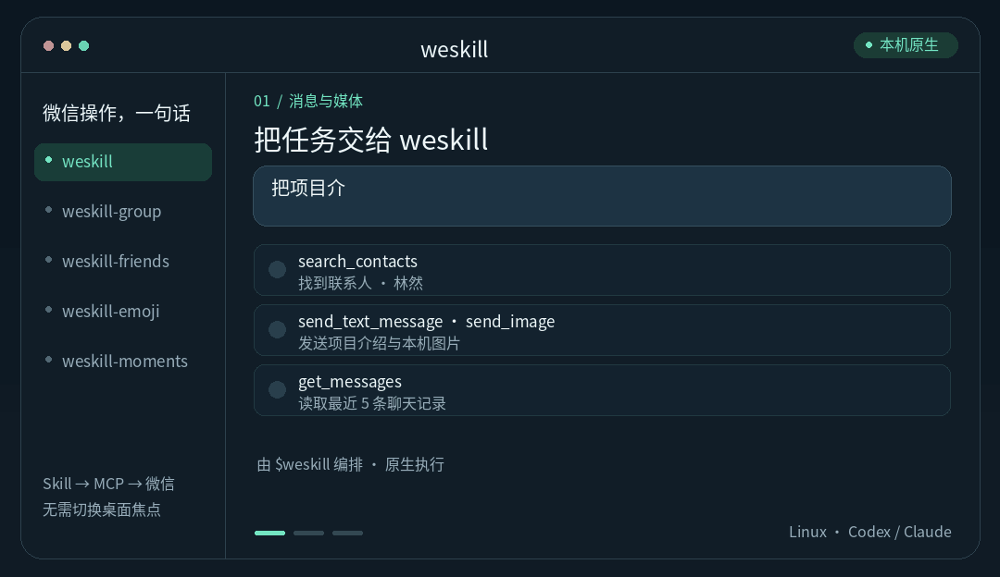

<p align="center">
  
</p>

<h1 align="center">weskill</h1>

<p align="center"><strong>强大的 Linux 微信 Skill，把一句话变成一连串微信操作。</strong></p>

<p align="center">
  <a href="LICENSE"></a>
  
  
  
</p>

weskill 让 Agent 直接操作 Linux 原生微信：查找联系人、理解聊天记录、发送消息与文件、管理好友和群聊、使用表情、读写朋友圈。一个总入口、五个协作 Skill、31 个 MCP 工具，让多步任务自然衔接。

底层通过原生调用执行，**不抢鼠标、不占键盘焦点、不切换窗口**。各个 Skill 复用本机服务与原生连接，服务空闲一小时自动退出，再次调用自动启动。

项目采用 [REA（Reverse Engineer Anything）](https://github.com/morluto/rea) 工作流逆向 Linux 微信，将 ELF 静态分析与 Frida 动态验证所得的原生能力封装成 MCP，再由 Skill 编排任务。探索方法与实现经验记录在 [开发指南](docs/DEVELOPMENT.md)。

[快速开始](#快速开始) · [能力目录](#能力目录) · [常驻响应控制流](#常驻响应控制流) · [开发文档](#开发文档)

<p align="center">
  
</p>

## 一句话，完成微信任务

> 把项目介绍和这张图片发给我指定的联系人，再整理最近 5 条聊天记录。
>
> 在指定群发布公告，@两位成员，并把指定消息置顶。
>
> 找一个开心的表情发给指定好友，再把这张图发为仅自己可见的朋友圈。

| Skill | 职责 |
| --- | --- |
| `$weskill` | 总入口、完整能力目录、搜索、历史与普通消息/媒体 |
| `$weskill-friends` | 好友资料、备注、添加好友与申请处理 |
| `$weskill-group` | 群成员、建群、邀请、管理设置与群协作 |
| `$weskill-emoji` | 系统表情、个人收藏与在线搜索表情 |
| `$weskill-moments` | 朋友圈时间线、个人动态与文字/图片发布 |

## 能力目录

<details>
<summary><strong>基础与消息 · 搜索、历史、文本、图片、文件</strong></summary>

- **联系人与群搜索**：按关键词、自定义条数和排序查找，支持只搜索群。`search_contacts`
- **聊天历史**：批量读取会话，默认 20 条；自定义条数，或用 `0` / `null` 读取全部本机可读记录；可返回原始 XML。`get_messages`
- **私聊与群聊文本**：共用原生发送接口。`send_text_message`
- **本地图片与文件**：按本机路径发送到好友或群。`send_image` / `send_file`
- **客户端与能力识别**：读取 ELF 架构、SHA-256、Build ID 和当前会话可用能力。`get_client_identity` / `get_capabilities`
- **共享服务**：启动、续期、查看状态或在空闲时停止。`ensure_service` / `get_service_status` / `stop_service`

</details>

<details>
<summary><strong>好友管理 · 资料、备注、主动添加、申请处理</strong></summary>

- **好友与群成员资料**：读取本地可用昵称、微信号、备注、签名、地区、头像、电话列表、标签与来源。`get_friend_info`
- **修改备注**：设置或清空好友备注。`set_contact_remark`
- **搜索新联系人**：使用原生网络搜索获取添加对象。`search_new_contact`
- **主动添加好友**：指定验证文字和备注。`add_friend`
- **查看好友申请**：分页或全量读取，区分申请方向与当前联系人关系。`list_friend_requests`
- **接受好友申请**：使用申请记录处理指定请求。`accept_friend_request`

[好友资料与参数说明](docs/FRIENDS.md)

</details>

<details>
<summary><strong>群管理 · 建群、邀请、成员、真实 @、公告、置顶</strong></summary>

- **群资料与成员**：查询公告、邀请确认状态、成员角色、群昵称及可用好友资料。`get_group_info` / `get_group_members`
- **发起群聊**：用指定好友创建群聊并设置名称。`create_group`
- **邀请入群**：向指定好友发起群聊邀请。`invite_group_members`
- **移出成员**：群主或管理员移出指定成员，提交前刷新本人角色。`remove_group_members`
- **真实 @**：向指定成员、多个成员或全体成员发送带原生提及元数据的消息。`send_group_mention`
- **群公告**：发布、编辑或清空完整纯文本公告。`set_group_announcement`
- **消息置顶**：按服务器消息 ID 置顶或取消。`pin_group_message`
- **邀请确认**：开关“入群需要群主或管理员同意”。`set_group_invitation_confirmation`

[群权限与操作说明](docs/GROUPS.md)

</details>

<details>
<summary><strong>表情 · 系统表情、收藏表情、在线搜索与发送</strong></summary>

- **系统表情**：发现客户端识别的表情代码，通过文本接口发送。`list_system_emojis` / `send_text_message`
- **个人收藏**：浏览收藏表情并选择素材。`list_saved_stickers`
- **在线搜索**：按关键词搜索，支持分页续读。`search_stickers`
- **发送自定义表情 / GIF**：复用微信原生下载与发送链路。`send_sticker`

[表情使用说明](docs/EMOJI.md)

</details>

<details>
<summary><strong>朋友圈 · 时间线、个人动态、文字与图片发布</strong></summary>

- **读取动态**：时间线、指定联系人的个人动态、游标分页与置顶内容。`get_moments`
- **发表动态**：纯文字或本机图片，明确指定公开或仅自己可见。`publish_moments`

[可见范围、图片处理与验证说明](docs/MOMENTS.md)

</details>

工具参数与返回值见 [工具参考](docs/TOOLS.md)，真实客户端验证范围见 [能力说明](docs/FEATURES.md)。

## 快速开始

原生执行适配 **Linux ARM64、微信 4.1.13.26 的指定构建**，微信位于 `/opt/wechat/wechat` 并已登录。准备 Python 3.12+、GCC 与可访问该微信进程的本机用户；构建识别方式见 [兼容性说明](docs/COMPATIBILITY.md)。

### 安装执行层

```bash
git clone https://github.com/cyrus-xc/weskill.git
cd weskill
python3 -m venv .venv
.venv/bin/python -m pip install -e '.[hooks]'
mkdir -p native/build .state
chmod 700 .state
gcc -std=c11 -O2 -fPIC -shared \
  native/readonly_executor_shim.c native/readonly_executor_shim.S \
  -o native/build/libreadonly-executor-shim.so
```

### 接入助手

在仓库根目录，按使用的宿主完成 MCP 注册和 Skill 安装：

<details open>
<summary><strong>Codex</strong></summary>

```bash
codex mcp add weskill -- \
  "$PWD/.venv/bin/python" "$PWD/scripts/run_local_mcp.py"
codex plugin marketplace add "$PWD"
codex plugin add weskill@weskill-local
```

</details>

<details>
<summary><strong>Claude Code</strong></summary>

```bash
claude mcp add --transport stdio --scope user weskill -- \
  "$PWD/.venv/bin/python" "$PWD/scripts/run_local_mcp.py"
claude plugin marketplace add "$PWD"
claude plugin install weskill@weskill-local
```

</details>

新开会话或重新连接 MCP，调用 `$weskill` 即可。助手先读取可用能力，再搜索目标和执行任务；重名联系人通过内部 ID 确定。Skill 插件与本机 MCP 执行环境分别安装，其他 MCP 客户端也可直接使用执行层。

客户端返回 `client_success` 即按发送成功处理。写操作使用持久幂等键，结果未知时不自动重发；运行记录保存在 `.state/`。参数、服务管理与连接排查见 [工具参考](docs/TOOLS.md)。

## 常驻响应控制流

weskill 与 [we-Agent](https://github.com/cyrus-xc/we-Agent) 联合开发、独立发布。在双仓架构中，we-Agent 承载“接收事件 → Agent 决策 → 执行操作 → 记录结果”的常驻响应控制流，以及流程、知识库、行为边界和看板；weskill 提供微信原生操作、事件采集职责与 Skill/MCP 接口。

```text
we-Agent   事件 → 流程 / 知识库 / Agent → 行动 → 结果记录
                                      │
weskill                   Skill / MCP → Linux 微信
```

weskill 可以独立用于交互任务。两仓职责、现有接口与事件边界见 [联合开发约定](docs/INTEGRATION.md)。

## 开发文档

- [如何探索与构建原生工具](docs/DEVELOPMENT.md)：从入口线索、ABI 和线程到回调生命周期、幂等与测试。
- [双仓库联合开发](docs/INTEGRATION.md)：接口归属、协作方式与发布约定。
- [工具参考](docs/TOOLS.md) · [能力与验证](docs/FEATURES.md) · [兼容性](docs/COMPATIBILITY.md) · [插件打包](docs/PLUGINS.md)。

```bash
.venv/bin/python -m unittest discover -s tests -v
.venv/bin/python scripts/check_release.py
```

原始研究、帐号数据与实验报告保留在本地忽略目录。工具使用本机 stdio 和同用户 Unix socket；查询结果会交给调用它的 AI 客户端。weskill 是采用 [MIT License](LICENSE) 的非官方项目，与腾讯、微信、OpenAI 或 Anthropic 无隶属关系。

## 引用与致谢

[REA](https://github.com/morluto/rea) · [Frida](https://frida.re/docs/home/) · [MCP Python SDK](https://github.com/modelcontextprotocol/python-sdk) · [Pillow](https://pillow.readthedocs.io/en/stable/) · [OpenAI 插件规范](https://developers.openai.com/plugins/build/plugins) · [Claude Code 插件规范](https://code.claude.com/docs/en/plugins-reference)。协议字段研究的更多参考见 [开发指南](docs/DEVELOPMENT.md#参考资料)。

觉得有用，欢迎给 **weskill 点一颗 Star ⭐**，也欢迎贡献新能力、兼容适配与使用反馈。
